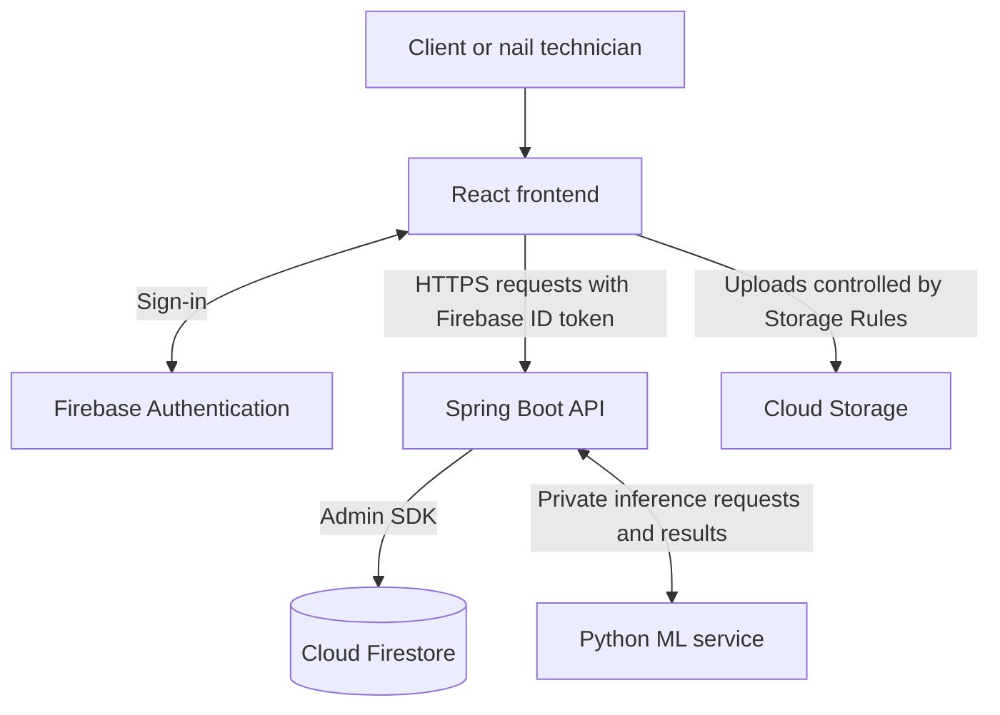

# NailTech Architecture 

## Project purpose

NailTech is a nail appointment booking platform for clients and
nail technicians. It will support browsing nail designs, managing
appointments and receiving ML-assisted design recommendations.

This document describes the intended architecture. The current
implementation contains a React frontend, a Spring Boot backend
and a working health-check connection between them.

## Technology stack

| Technology | Responsibility |
|---|---|
| React | Browser interface |
| Vite | Frontend development server and build tool |
| Tailwind CSS | Styling |
| Java 21 and Spring Boot | Backend API and business rules |
| Gradle | Java dependencies, testing and builds |
| Firebase Authentication | Registration and sign-in |
| Cloud Firestore | Application data |
| Cloud Storage for Firebase | Image files |
| Python | ML experiments and inference |

## Architecture diagram



## Component responsibilities

### Frontend

- Display pages, forms and application results.
- Sign users in through Firebase Authentication.
- Send Firebase ID tokens with protected backend requests.
- Upload images under the signed-in user's permitted Storage path.

### Backend

- Verify Firebase ID tokens.
- Validate input and enforce user permissions.
- Manage profiles, services, bookings and design records.
- Prevent conflicting bookings using transactional checks.
- Access Firestore and coordinate requests to the ML service.

### Firebase

- Authentication manages user accounts and identity.
- Firestore stores structured application data.
- Cloud Storage stores images separately from database records.

### Python ML service

- Load the trained model.
- Process authorised inference requests from Spring Boot.
- Return recommendations with a model version.
- Keep model training separate from application request handling.

## Main data flows

### Sign-in

1. The user signs in through Firebase Authentication.
2. React obtains a Firebase ID token.
3. React includes the token in protected API requests.
4. Spring Boot verifies the token and checks permissions.

### Booking an appointment

1. React requests a technician's services and availability.
2. The client submits a service and appointment time.
3. Spring Boot checks identity, input and availability.
4. Spring Boot reserves the required time slots and creates the
   booking atomically in Firestore.
5. React displays the confirmed booking.

### Browsing and saving designs

1. React requests designs from Spring Boot.
2. Spring Boot retrieves the permitted records from Firestore.
3. The user saves a favourite.
4. Spring Boot stores it under the authenticated user's ID.

### Image upload

1. The user uploads an image to their permitted Storage path.
2. Storage Rules check ownership, file size and content type.
3. React submits the storage path to Spring Boot.
4. Spring Boot validates ownership and stores image metadata.

### ML recommendation

1. React submits a recommendation request to Spring Boot.
2. Spring Boot validates the request and access to any input image.
3. Spring Boot sends the authorised input to the Python service.
4. Python returns results and the model version.
5. Spring Boot returns the results to React and stores them if needed.

## Firestore collections

The following structure is an initial design.

| Collection or path | Example fields |
|---|---|
| users/{userId} | displayName, role, createdAt |
| technicians/{technicianId} | userId, bio, businessName |
| services/{serviceId} | technicianId, name, durationMinutes, priceMinor, currency |
| bookings/{bookingId} | clientId, technicianId, serviceId, startAt, endAt, status |
| technicians/{technicianId}/slots/{slotId} | startAt, endAt, bookingId |
| designs/{designId} | ownerId, title, tags, imagePath, visibility |
| users/{userId}/favourites/{designId} | createdAt |
| uploads/{uploadId} | ownerId, storagePath, createdAt |
| recommendations/{recommendationId} | userId, modelVersion, results, createdAt |

Document IDs link records across collections. Firestore does not
enforce relational foreign keys; Spring Boot validates references.

Bookings use a defined slot duration. A booking reserves every slot
it occupies in one transaction to prevent overlapping appointments.
Cancellation releases those slots transactionally.

Store appointment timestamps consistently and convert them to the
appropriate time zone for display.

## Security boundaries

- React is an untrusted client; backend checks are authoritative.
- Spring Boot verifies Firebase ID tokens using the Admin SDK.
- Users can access only records permitted by their identity and role.
- Users cannot assign themselves privileged roles.
- Application data is accessed through Spring Boot; direct browser
  access to Firestore is denied by Firestore Security Rules.
- The Admin SDK bypasses Firestore Security Rules, so Spring Boot
  must enforce ownership and permissions itself.
- Storage Rules restrict private image access to permitted users.
- Firebase Admin credentials stay outside Git and the frontend.
- The Python service accepts authenticated backend requests and
  is not exposed directly to the browser.
- Production connections use HTTPS.
- Logs must not contain tokens, credentials or private image data.

## Repository structure

```text
FYP/
├── backend/       # Spring Boot API
├── frontend/      # React application
├── docs/          # Architecture and documentation
├── ml/            # Python ML code
├── .gitignore
└── README.md
```

## Local development

- React runs at http://localhost:5173.
- Spring Boot runs at http://localhost:8080.
- Vite forwards /api requests to Spring Boot during development.
- GET /api/health provides a basic backend connectivity check.